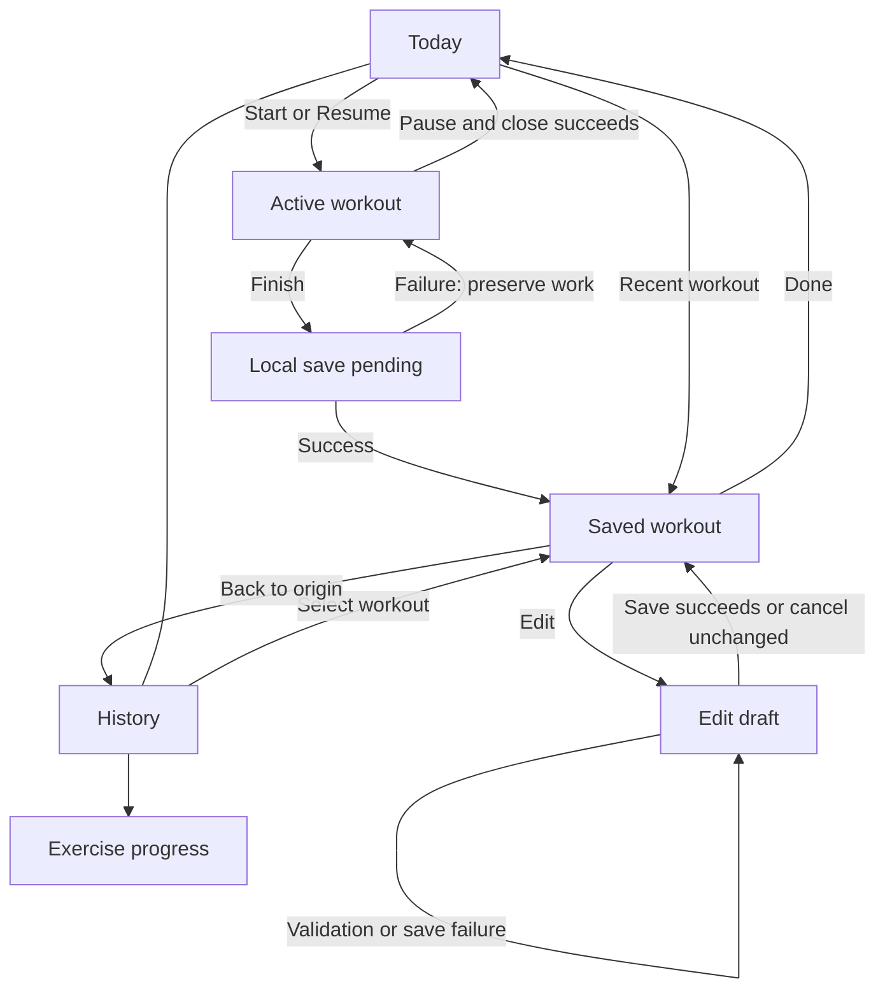

# Form — Counterweight flow and state model

Status: proposed product model, 8 November 2026. This replaces the earlier flow proposal; it does not describe an implemented SwiftUI redesign. The Counterweight conversation previews are interaction studies with synthetic records and simulated persistence. Native behavior and prior verification are documented in [IOS_STATE_AUDIT.md](IOS_STATE_AUDIT.md).

## Product contract

Let someone start training quickly, work in any order, record what actually happened, stop deliberately, and find or correct it later. Make the interaction recognizable through Counterweight's physical responses and restrained composition. Preserve data and recovery responsibilities, not the previous screen count.

Retain the prescribed A/B routine, existing records, optional Health integration, and local backups. Do not introduce onboarding questionnaires, equipment setup, routine generation, or exercise substitution as part of this redesign. The dormant planner is outside current production navigation. The app stores data locally; there is no iCloud-sync state to design.

## Surfaces and navigation

Two top-level destinations remain: Today and History. Settings is a sheet reachable from either. The active workout occupies a focused surface with an explicit Pause and close action. Essential actions always have visible, accessible controls; gestures are optional shortcuts.

| Surface | User goal | Content and actions |
| --- | --- | --- |
| Today | Decide what to do now | Next prescribed session and Start; or unfinished session and Resume. View routine is secondary. A recent saved record is a link, not a second active session. |
| Workout — active | Record and manage current training | Exercise names, recorded/planned sets, fields and Log set; movement selection, reordering, set tools, cardio, rest, Pause and close, Finish. |
| Workout — saved | Review or correct completed work | Routine, date, factual totals and recorded work. Details disclose in place. Edit creates a draft. First arrival after saving briefly acknowledges Saved. |
| History | Find a workout or understand progress | Sessions and Overview; workout detail uses the shared saved surface. Exercise search and progress are nested destinations. Empty and no-results states stay factual. |
| Settings and data | Manage preferences and integrations | Load increment, awake-screen preference, optional Health connection/status. Backups remain reachable from History options and empty History. |

Completion and reopening a record use the same saved-workout model. Expanded details, first-save acknowledgement, and arrival from Today versus History do not create different record types. Back returns to the actual origin. Done after finishing returns to Today.

The routine sheet remains informational. Starting a session does not require visiting it. Exercise progress remains a nested analysis view; it is not another main tab.

## Primary journey

The Back-to-History edge applies only to records opened from History. A record opened from Today returns to Today. The pending save is an operation inside the workout surface, not a mandatory new page.

## Goal-by-goal decisions

### 1. Start or return without losing work

Today has three mutually exclusive primary conditions: ready to start, unfinished session available, or recovery blocked. A recently finished session may coexist with ready-to-start; it must never be offered as Resume.

Resume keeps the same session identity, exercise order, recorded sets, draft values, position, elapsed-time anchors and walk state. A stale unfinished session shows its start date with Resume and a secondary deliberate discard action; age alone never deletes it.

While restoration is unresolved, do not offer a Start action that could overwrite it. Missing data allows a new start; unreadable/newer/incompatible data offers Retry and confirmed Discard while preserving original bytes. A stale Live Activity link creates no session and cannot reopen a completed one.

### 2. Work in the order that suits the gym

The active surface is a workout with an exercise list, not a sequence of required pages. Selecting a movement expands its editable area in place. Other movement names and progress remain reachable through a visible Exercises control; selecting a movement never logs or skips it automatically. Reordering lives in that list and affects this session only.

Preserve warm-up/working-set controls, adding/removing sets, previous performance, measurement-specific fields and existing rest preferences. A fully recorded movement becomes a compact completed entry with recorded values. There is no separate exercise-complete page or compulsory Continue action. Reopen it to correct or unmark a set.

Keep identity and scroll position stable across expansion. If animation is used, the selected movement remains identifiable throughout; do not move an input away while someone is editing it.

### 3. Log a set and rest without surrendering control

A valid Log set action records once immediately. The character compresses with press, gives a short release response on recording, then settles if rest starts. Animation is feedback, never the authority for saving or unlocking controls. Repeated input must not duplicate a set. Rest and completion animations do not run on restoration.

Rest is an independent condition of the active workout, not a route. Keep one session rest deadline, associated with the set that started it. Keep exercise selection, fields, logging, walk access and Finish usable. Another completed eligible set replaces that deadline. Undo cancels rest only when it belongs to the undone set; it does not cancel a newer set's timer.

Retain per-exercise and warm-up rest preferences, including no automatic rest where configured. Do not hard-code the preview's two-minute interval into the product.

If no planned working sets remain, do not automatically start another rest merely to place a timer between training and finishing. Offer manual Rest from the workout actions for someone continuing with extra work. If planned sets remain elsewhere, normal configured rest still applies. Adding a set makes it part of the remaining work.

Controls: subtract/add 30 seconds, Skip, and a quiet Ready state on expiry. Expiry never changes movement, logs work or finishes the session. With a keyboard open, rest becomes compact. Keep its deadline across foreground/background transitions; explicit Pause and close stops active duration and walk accumulation, while an existing rest deadline continues by wall clock.

### 4. Record cardio without a forced handoff

Cardio is reachable at any point from the workout, not a mandatory final page. A walk can be running while the user reviews or edits strength work. Starting and finishing a timed walk is explicit; a manually recorded walk remains an alternative.

Preserve actual duration, optional distance/speed/incline, supported activity types in saved records, multiple entries and deletion. Do not imply a suggested duration or console setting was performed. Untouched suggestions are not recorded data.

On confirmed finish, include an ongoing walk exactly once at the finish time. A request to finish or a cancelled decision must not stop it. On save failure, restore the running walk and prior cardio state before continuing.

### 5. Finish deliberately, without a ceremony

Finish is always reachable. Show the amount of recorded work nearby, so finishing means saving actual work rather than satisfying a prescribed checklist.

| Situation | Proposed behavior |
| --- | --- |
| Recorded work, only untouched planned work remains | Finish saves recorded work directly. Partial training is valid; no generic partial-session confirmation. |
| Entered but unrecorded set values or incomplete manual cardio would be excluded | Show a compact review sheet naming the affected entries. Offer Keep training or Save recorded work. Explain that unrecorded entries will be omitted. Do not silently mark them complete. |
| Invalid input in work being saved | Focus the field and explain the correction inline. No save mutation. |
| Invalid input only in an unrecorded draft | The exclusion sheet may explicitly discard that draft. Keep training returns its raw text intact. |
| No recorded sets or cardio, and no elapsed walk | Offer End workout or Keep training. Ending clears the active session but creates no empty History record and does not advance A/B. |
| Walk currently running | Review identifies that it will be included up to finish. Confirmation commits its elapsed time once. |
| Save pending | Keep the workout visible. Block duplicate Finish and conflicting edits; show activity feedback only if the wait is perceptible. |
| Local save failure | Keep the active session and values. Explain the failure at the finish action with Retry; remain in the workout. Do not show Saved or play completion feedback. |
| Local save success | Transition this workout to its saved presentation; end active timers/notifications, clear or retire the active snapshot, advance A/B once. Optional Health sync proceeds independently. |

The exclusion sheet is driven by draft dirtiness, not simply by incomplete planned rows. Prefilled defaults or suggestions are not user-authored drafts. A change to an already recorded set is part of the work being saved and must validate. Multiple reasons for review (walk plus draft exclusion) share one sheet, not stacked dialogs.

The no-empty-record decision is an intentional change from the existing native Finish empty session branch. Historical empty or legacy records remain readable and are not migrated away.

### 6. Review the result and move on

Use one saved-workout surface for first completion and later viewing. Show routine/date, a small Saved acknowledgement on first arrival, and relevant factual totals. Show warm-ups, strength work and fractional cardio accurately; omit irrelevant metrics and empty sections. Do not add routine praise, rotating slogans, confetti or streak judgments.

Counterweight settles against the blue weight; the action mark resolves to a small saved check. The motion follows confirmed persistence. Done is available immediately on save success even if the decorative motion is still finishing. Reduce Motion produces the same settled state without travel or squash.

Details expand in place. Done returns to Today without an active-session prompt. Opening the same workout later shows the same data, without replaying a completion celebration. Preserve originating tab and History scroll position.

### 7. Correct a record without confusing it with a live workout

Edit creates a separate draft of the saved workout. Support title, date/time, duration, sets and set types, cardio fields and add/remove operations. Preserve values for legacy activities and unknown exercises.

Save validates, commits, then updates the shared record surface and queues any Health change. Failure retains the draft and original saved record for retry. Cancel unchanged closes directly; Cancel changed asks before discarding the draft. Back and interactive dismissal follow the same policy.

Delete remains in record/history actions with explicit confirmation because local deletion is not recoverable through an in-app trash. Cancellation changes nothing; failure retains the record. Do not introduce an Undo deletion promise without a real recovery mechanism.

### 8. Find patterns and manage data

Keep chronological History, Overview, exercise search and exercise progress. Search distinguishes an empty query from no matches. Progress distinguishes no data, a single baseline and a usable trend; period and metric filters reflect the exercise's measurement type. Retain the coaching-report share action.

Backups use native share and Files surfaces. Cancellation is silent. Report newly restored records, duplicate-only imports, invalid/newer formats and failures accurately. Restore is transactional and nonduplicating. Empty History offers Restore without requiring a saved workout first.

Health states remain optional and separate from local-save success: unavailable, not connected, connecting, authorized/denied as the API permits, queued work, sync error and refresh/retry. Never imply HealthKit read access is known when the platform does not expose it. Ask for permissions at the relevant action; denial never blocks local training. Rest notifications and Live Activities are enhancements, not requirements.

## State ownership

Model these independently rather than constructing one enum for every visual combination:

| Dimension | Values / ownership |
| --- | --- |
| Navigation | Today, History, workout origin; routine/settings/exercise-list sheets; nested progress |
| Workout lifecycle | No active session, active, paused, saved; one stable session ID |
| Data operation | Idle, restoring, writing snapshot, pausing, finishing, editing save, deleting, importing; failed operation with retry context |
| Entry | Raw field drafts, focus, validation and dirty state, separately from last valid persisted values |
| Rest | None, running(deadline, source set), ready(source set) |
| Walk | Not running or timed walk with duration anchor; follows explicit pause/resume |
| Record presentation | Details disclosure and optional first-save acknowledgement, not separate records |
| Integration | Independent Health queue/status and notification authorization |

Rest can coexist with editing, movement selection or a walk. A saved workout cannot coexist with an active timer for the same session. A save failure cannot produce the saved presentation. Pause closes only after the snapshot write succeeds. Acknowledgement animations are transient view effects and never persisted lifecycle states.

Persist dirty raw drafts and stable set IDs in a versioned snapshot before allowing invalid unfinished input to survive Pause and close. The existing native snapshot retains only valid numbers and currently recreates set UUIDs on restoration. Until migration and restoration are implemented, retain its current validation-before-pause behavior; do not silently claim raw-draft or rest-source restoration.

If a write succeeds but snapshot cleanup fails, durable saved-session identity must suppress Resume for that session. Preserve the repository's completed-record reconciliation and exercise it again in migration tests.

## Coverage reconciliation against the repository

“Preserve” means the responsibility survives. “Merge” changes presentation. “Change” is intentional behavior that needs implementation and regression coverage. All rows below are proposed Counterweight coverage, not completed validation.

| Existing reachable responsibility | Counterweight destination / decision | Treatment | Acceptance evidence required |
| --- | --- | --- | --- |
| First-use and next-session Today | Same ready state, actual next A/B | Merge | First use starts once; no fake achievements |
| Active session and paused resume | Today Resume → same active workout | Preserve | IDs, order, sets and duration survive close/relaunch |
| Missing/corrupt/newer session snapshot | Today recovery condition | Preserve | Retry/discard; damaged bytes protected; no accidental overwrite |
| Routine preview | Informational sheet | Preserve | A/B prescription and last cardio note reachable |
| Sets completed out of order | In-place exercise selection | Preserve | Log later movement, return, edit and undo without reset |
| Reorder, set types and set tools | Exercise list and local controls | Preserve | Order and warm-ups survive resume; changes affect current session only |
| Exercise-complete summary page in prototype | Completed movement in active surface | Merge | No required Continue; completed values still editable |
| Rest deadline/preferences/adjustment | Independent active-workout condition | Preserve | Expiry, adjustment, keyboard and relaunch agree |
| Automatic final rest | Suppress when no planned working sets remain; manual Rest available | Change | Last planned set reaches finish without a compulsory countdown |
| Set undo during newer rest | Rest tied to initiating set | Change | Undo older set leaves newer rest intact; source survives resume |
| Numeric fields and keyboard navigation | Shared validated editor | Preserve | Required/optional, decimals, precision, locales, limits and focus retain current measurement rules |
| Invalid raw drafts across pause/relaunch | Versioned raw draft support | Change | Invalid text restored; old snapshots migrate; no silent truncation |
| Timed walk and manual cardio | Optional section in active workout | Merge | Walk may coexist with strength work; included once on finish |
| Pause and close write failure | Remain active with recovery action | Preserve | Failure retains work and timing; retry closes only on success |
| Discard active session | Confirmed secondary action | Preserve | Failure stays open; no A/B advancement |
| Generic partial-finish confirmation | Review only for excluded entered work or active walk | Change | Untouched planned rows do not trigger a warning; entered data is never silently omitted |
| Empty finish | End without creating a record | Change | No History insert, no sequence advancement; legacy empty records remain readable |
| Finish persistence and duplicate taps | Guarded operation in active surface | Preserve | Repeated taps save once; failure restores walk; retry does not duplicate |
| Completion + saved History detail | Shared saved-workout surface | Merge | Same totals, disclosures and legacy content from both entry paths |
| Today after finishing | Ready state plus recent-record link | Preserve | Finished session never appears as Resume, including cleanup failure |
| Empty/populated History and Overview | History with content conditions | Preserve | Empty restore available; last row clears bottom controls |
| Exercise search/progress | Nested History destinations | Preserve | Clear/no-results, baseline/trend, period and supported metrics |
| Saved-workout editor | Draft over shared saved record | Preserve | Cancel policy, validation, rollback and successful Health update queue |
| Confirmed deletion and failure | Record/history actions | Preserve | Record remains on failure; Health removal queued after local success |
| Backup import/export and report share | History data actions / native system surfaces | Preserve | Cancel, duplicates, invalid/newer file, rollback and round trip |
| Preferences and local-storage explanation | Settings | Preserve | No iCloud promise; preference controls retain effects |
| Health authorization/queue failure | Independent integration state | Preserve | Local save works without Health; pending jobs and failures remain recoverable |
| Background, lock, notification and deep-link entry | Same active state and restoration rules | Preserve | Matching/stale IDs, anchors and declined permissions handled |
| Keyboard, large type, accessibility and Reduce Motion | Conditions of every surface | Preserve | Actions remain reachable; meaningful focus; no timer announcement each second |

## Visual and interaction rules

- Keep the approved dark-ink, white-space and muted-blue Counterweight direction. Small character, restrained system/grotesk type; no handwriting or paper-card metaphors inherited merely because they exist in SwiftUI today.
- The character reflects the most relevant state (recording, resting, finishing). It never provides the only indication of success or error and does not act as an exercise-technique diagram.
- Keep the fields and current action spatially stable. Press response is immediate; ongoing timers remain quiet. No looping decorative motion or waits for a character performance.
- Name actions clearly: Start, Resume, Log set, Rest, Finish, Saved, Edit, Done. Add specific explanatory copy only when a choice could lose work or a failure needs recovery.
- Keep error messages beside the affected action/field where possible. System pickers and consequential confirmations retain native semantics. Minimal copy must not remove units, field context or accessible action names.
- Support Dynamic Type, Reduce Motion, keyboard dismissal/navigation, adequate contrast and 44-point touch targets throughout. Reveal/focus invalid fields above the keyboard and rest controls. Focus should remain meaningful after every sheet or route change.
- Physical-iPhone testing remains excluded at the user's request. Simulator inspection and automated tests are evidence with limits, not a substitute claim for physical VoiceOver, haptics or Health delivery.

## Next build and verification boundary

The next interactive build should demonstrate Today → active workout → saved workout → History using this model. Include any-order exercise selection, inline rest, final-set behavior, Pause/Resume, partial finish, unrecorded-draft review, empty end, editable saved work and explicit failure examples. Use clearly identified sample data; failure examples must be labelled as simulations outside the product UI.

Then implement in native SwiftUI behind the shared lifecycle/persistence layer, retaining existing tests. New behavioral regression coverage should target final-rest eligibility, rest ownership, raw-draft snapshot migration, conditional finish review, empty end, deduplicated save and cleanup recovery. Re-run the existing pause/walk/backup/editor/Health queue tests after integration. Visually inspect the affected states and large-text/keyboard layouts in the isolated simulator; leave the user's review simulator untouched.

Do not mark a coverage row complete because its appearance exists. Each row needs a reachable action, correct success outcome, cancellation/failure behavior where relevant, and the specified evidence. Do not infer that this proposal or the current HTML previews satisfy the native audit.
